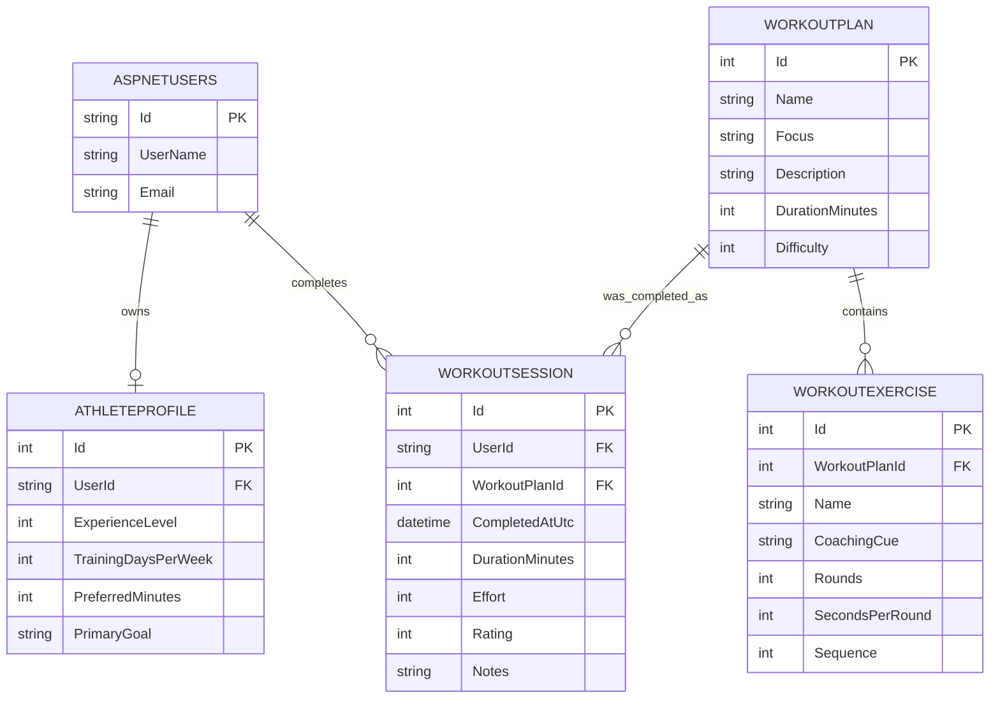

# Database Documentation

## 1. Purpose

This application stores two kinds of data in one SQLite database:

- Identity and security data managed by ASP.NET Core Identity.
- Boxing coaching data managed by the application domain model.

The database is intentionally small and predictable. It supports athlete self-profiling, a reusable workout catalog, and historical training records.

---

## 2. Data Model Summary

The application uses the following entities:

- `AspNetUsers` (from ASP.NET Core Identity base class)
- `AthleteProfiles`
- `WorkoutPlans`
- `WorkoutExercises`
- `WorkoutSessions`

These tables support the following primary workflows:

1. A user creates one profile.
2. The system chooses from a reusable catalog of workout plans.
3. Each plan contains ordered exercises.
4. When the athlete completes a workout, the app records a session with actual metrics and notes.

---

## 3. Entity Definitions and Expected Data

### 3.1 AspNetUsers

This table is created by ASP.NET Core Identity and is not custom-written in the app domain model.

Expected data:

- `Id`: GUID or string identifier for the authenticated user
- `UserName`: login name or email-based username
- `Email`: user email
- `NormalizedUserName`, `NormalizedEmail`: identity lookup fields
- `SecurityStamp`, `PasswordHash`, `ConcurrencyStamp`: account security metadata

Example:

| Id | UserName | Email | EmailConfirmed |
| --- | --- | --- | --- |
| 8c1d4d... | boxer.alpha | boxer.alpha@example.com | 1 |
| 9afab9... | boxer.beta | boxer.beta@example.com | 0 |

Business rule:

- One identity user can have zero or one `AthleteProfile`.
- The app enforces this with a unique index on `AthleteProfiles.UserId`.

### 3.2 AthleteProfiles

Purpose:

This table holds the athlete's personal training preferences used to rank workout recommendations.

Expected columns:

- `Id` (PK)
- `UserId` (FK to `AspNetUsers.Id`)
- `ExperienceLevel` (1-5)
- `TrainingDaysPerWeek` (1-7)
- `PreferredMinutes` (10-180)
- `PrimaryGoal` (e.g. `Technique`, `Conditioning`, `Defense`, `Power`, `Recovery`)

Example records:

| Id | UserId | ExperienceLevel | TrainingDaysPerWeek | PreferredMinutes | PrimaryGoal |
| --- | --- | ---: | ---: | ---: | --- |
| 1 | 8c1d4d... | 2 | 4 | 45 | Technique |
| 2 | 9afab9... | 4 | 3 | 50 | Power |

Validation constraints:

- `ExperienceLevel` is between 1 and 5.
- `TrainingDaysPerWeek` is between 1 and 7.
- `PreferredMinutes` is between 10 and 180.
- `PrimaryGoal` is a short text code/focus label.

### 3.3 WorkoutPlans

Purpose:

This is the reusable coaching catalog. Each plan describes a training template that can be recommended to many athletes.

Expected columns:

- `Id` (PK)
- `Name`
- `Focus`
- `Description`
- `DurationMinutes`
- `Difficulty`

Example catalog entries seeded by the app:

| Id | Name | Focus | Description | DurationMinutes | Difficulty |
| --- | --- | --- | --- | ---: | ---: |
| 1 | Sharp Fundamentals | Technique | Build clean mechanics, balance, and a reliable one-two. | 35 | 1 |
| 2 | Engine Room | Conditioning | Fight-paced intervals that train repeatable output under fatigue. | 45 | 3 |
| 3 | Counterpunch Lab | Defense | Read, defend, and answer without surrendering position. | 40 | 3 |
| 4 | Heavy Hands | Power | Develop force from the floor while preserving shape and recovery. | 50 | 4 |
| 5 | Recovery Rounds | Recovery | Low-intensity movement for skill retention and active recovery. | 25 | 1 |

Expected business behavior:

- The app seeds these values when the catalog is empty.
- Recommendation logic compares a profile goal to `WorkoutPlan.Focus`.

### 3.4 WorkoutExercises

Purpose:

This table stores the ordered exercise list that forms each workout plan.

Expected columns:

- `Id` (PK)
- `WorkoutPlanId` (FK to `WorkoutPlans.Id`)
- `Name`
- `CoachingCue`
- `Rounds`
- `SecondsPerRound`
- `Sequence`

Example row set for `Sharp Fundamentals`:

| Id | WorkoutPlanId | Name | CoachingCue | Rounds | SecondsPerRound | Sequence |
| --- | ---: | --- | --- | ---: | ---: | ---: |
| 1 | 1 | Footwork lines | Stay over your hips and finish every step in stance. | 3 | 120 | 1 |
| 2 | 1 | Jab-only shadowboxing | Snap the hand home and keep the rear hand glued to your cheek. | 3 | 180 | 2 |
| 3 | 1 | One-two on the bag | Turn the rear hip through without reaching. | 4 | 180 | 3 |

Business rule:

- Exercises are physically owned by their parent plan.
- Deleting a plan cascades to its exercises.
- Sequence controls display order and execution order.

### 3.5 WorkoutSessions

Purpose:

This table records a completed workout instance. It captures actual athlete performance and subjective experience instead of repeating the reusable plan definition.

Expected columns:

- `Id` (PK)
- `UserId` (FK to `AspNetUsers.Id`)
- `WorkoutPlanId` (FK to `WorkoutPlans.Id`)
- `CompletedAtUtc`
- `DurationMinutes`
- `Effort` (1-10)
- `Rating` (1-5)
- `Notes`

Example data:

| Id | UserId | WorkoutPlanId | CompletedAtUtc | DurationMinutes | Effort | Rating | Notes |
| --- | --- | ---: | --- | ---: | ---: | ---: | --- |
| 101 | 8c1d4d... | 1 | 2026-10-15T18:35:00Z | 35 | 7 | 4 | Good rhythm and cleaner guard position. |
| 102 | 8c1d4d... | 2 | 2026-10-16T06:10:00Z | 45 | 8 | 5 | Felt strong but needed better breathing. |

Business rule:

- Sessions retain a reference to the original workout plan for historical context.
- Plan records remain protected from delete if they are referenced by sessions.

---

## 4. ERD Model



---

## 5. 3NF Review and Recommendation

This schema is largely aligned with Third Normal Form (3NF).

### 5.1 Why it is 3NF-compliant

- Each table has a single purpose.
- Each non-key attribute depends on the primary key, not on a partial key or another non-key field.
- Repeating groups are avoided.
- Plan content is separated from completed workout history.
- User-specific profile data is separated from generic plan catalog data.

### 5.2 Examples of normalization

- `WorkoutPlan` stores only plan attributes; exercise details live in `WorkoutExercises`.
- `WorkoutSession` stores actual completion data separately from reusable plan definitions.
- `AthleteProfile` stores one row per user with no duplicated user data.
- `WorkoutExercises` use `Sequence` for ordering instead of creating repeating columns like `Exercise1`, `Exercise2`, `Exercise3`.

### 5.3 Optional future improvement

The current model is already 3NF, but there is one design choice worth considering if the system grows:

- `PrimaryGoal` and `WorkoutPlan.Focus` are free-form text values such as `Technique`, `Conditioning`, and `Defense`.

If the app grows to support more complex reporting, translations, or controlled validation, these values should become a lookup table such as:

- `TrainingFocus` (`Id`, `Code`, `DisplayName`)

Then `AthleteProfiles.PrimaryGoal` and `WorkoutPlans.Focus` would reference that lookup instead of storing raw strings directly.

This would improve referential integrity and reduce spelling drift, but it is not required for the current small coaching catalog.

### 5.4 Final assessment

The current model is suitable for a 3NF relational design for the present scope. It avoids duplication, keeps relationships explicit, and preserves the distinction between:

- user identity,
- athlete preferences,
- training catalog,
- line-item exercise definitions,
- completed workout history.

---

## 6. Expected Data Invariants

The application expects the following invariant behavior:

- one athlete profile per user,
- many exercises per workout plan,
- zero or many workout sessions per user,
- many sessions can reference the same plan,
- plan deletion is blocked if session records still reference it,
- exercise ordering is meaningful and should be maintained by `Sequence`.

---

## 7. Suggested Validation Queries

These queries help validate the expected state of the database:

```sql
-- One profile per user
SELECT UserId, COUNT(*)
FROM AthleteProfiles
GROUP BY UserId
HAVING COUNT(*) > 1;

-- Plans with no exercises
SELECT p.Id, p.Name
FROM WorkoutPlans p
LEFT JOIN WorkoutExercises e ON e.WorkoutPlanId = p.Id
GROUP BY p.Id, p.Name
HAVING COUNT(e.Id) = 0;

-- Sessions referencing missing plans
SELECT s.Id, s.WorkoutPlanId
FROM WorkoutSessions s
LEFT JOIN WorkoutPlans p ON p.Id = s.WorkoutPlanId
WHERE p.Id IS NULL;

-- User session count by athlete
SELECT UserId, COUNT(*)
FROM WorkoutSessions
GROUP BY UserId;
```

---

## 8. Summary

The database design cleanly separates reusable training catalog data from athlete-specific and completion-specific data. This separation preserves integrity and makes the schema compatible with a normalized relational model. The current design is a strong fit for 3NF and supports the app's recommendation and historical-tracking features without unnecessary duplication.
